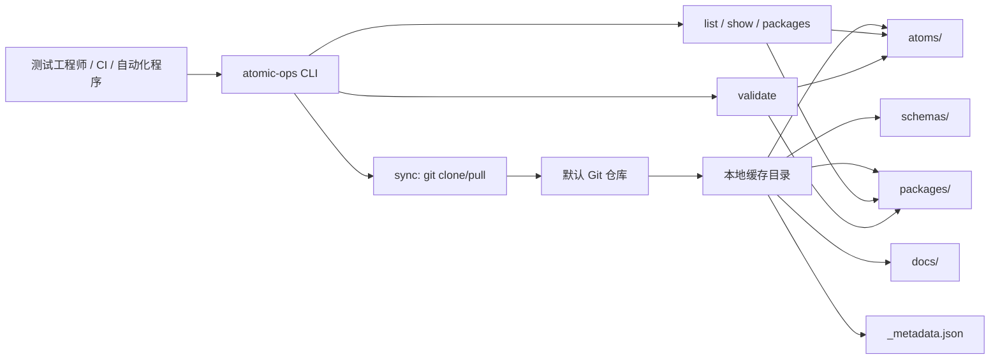

# atomic-ops

防火墙测试原子操作规范仓库与本地消费 CLI。

## 目录

- [1. 项目定位](#1-项目定位)
- [2. 已交付能力](#2-已交付能力)
- [3. 实现原理](#3-实现原理)
- [4. 架构概览](#4-架构概览)
- [5. 快速开始](#5-快速开始)
- [6. 核心命令](#6-核心命令)
- [7. 目录结构](#7-目录结构)
- [8. 本地缓存](#8-本地缓存)
- [9. 错误码速查](#9-错误码速查)
- [10. 安全边界](#10-安全边界)
- [11. 文档](#11-文档)
- [12. 版本信息](#12-版本信息)

## 1. 项目定位

`atomic-ops` 面向防火墙测试工程师、自动化编排程序和维护者，解决"原子操作描述不统一、测试用例引用不稳定、操作库难以本地查询和校验"的问题。

本仓库同时承担两类职责：

- **原子操作规范仓库**：提供 `schemas/`、`atoms/`、`packages/`、`docs/` 等可被同步的操作库内容。
- **Python CLI 包**：提供 `atomic-ops` 命令，通过 git 将操作库同步到本地缓存，并在本地执行查询和引用校验。

默认原子操作仓库地址：

```text
git@<GITLAB_HOST>:<ORG/PROJECT>/ptm-atomic.git
```

## 2. 已交付能力

| 能力 | 说明 |
|---|---|
| 原子操作 schema | `schemas/atomic-op.schema.yaml` 定义单个 atom YAML 的字段、必填项、枚举和结构约束。 |
| 字段参考文档 | `docs/schema-field-reference.md` 说明 schema 字段、历史术语映射和最小合法示例。 |
| 命名规范 | `docs/naming-convention.md` 固定 `op_id` 形态：`^(fw\|tg\|mock\|sw)_[a-z]+_[a-z_]+$`。 |
| 错误码规范 | `docs/error-codes.md` 定义 9 个操作级 `error_type` 与 5 个 CLI 级 `error_code`。 |
| 仓库布局检查 | `scripts/layout_check.py` 校验仓库根目录、设备目录和示例 atom 布局。 |
| schema 校验脚本 | `scripts/validate_schema.py` 校验单个或批量 atom YAML 是否符合 schema。 |
| 示例 atom | `atoms/fw/fw_verify_acl_rule.yaml` 提供当前最小可消费示例。 |
| package 清单 | `packages/networking.yaml`、`packages/security.yaml` 作为查询和校验过滤视图。 |
| CLI 同步 | `atomic-ops sync` 使用 git clone/pull 和 sparse checkout 管理本地缓存。 |
| CLI 查询 | `atomic-ops list`、`atomic-ops show`、`atomic-ops packages` 读取本地缓存。 |
| CLI 校验 | `atomic-ops validate` 校验测试用例或 package 中的 `op_id` 引用。 |
| 工程师资料 | `docs/engineer-handbook.md` 与 `docs/test-case-template.yaml` 支持首次使用、贡献和测试用例编写。 |

## 3. 实现原理

### 离线优先同步模型

CLI 只在执行 `sync` 时访问远端 git 仓库。同步完成后，`list`、`show`、`packages`、`validate` 都只读取本地缓存，不做实时网络请求。

本地存在两份物理上解耦的副本：

| 副本 | 更新方式 | 内容 |
|---|---|---|
| CLI 本体 | `uv tool install` / `uv tool upgrade atomic-ops` | `atomic-ops` 命令、Python 依赖和命令实现。 |
| 操作库缓存 | `atomic-ops sync` | sparse checkout 后的 `atoms/`、`schemas/`、`packages/`、`docs/` 和 `_metadata.json`。 |

升级 CLI 不会自动更新 atom 数据；同步操作库也不会修改 CLI 安装目录。

### 核心数据模型

单个 atom 以 YAML 文件表达，路径必须与 `op_id` 前缀和 `device_type` 一致：

```text
atoms/<device_type>/<op_id>.yaml
```

package 是过滤视图，不复制、不安装 atom 文件。package 清单只维护一组 `op_id`：

```yaml
package_id: networking
display_name: Networking
description: Network reachability and firewall policy verification operations.
version: "1.0.0"
operations:
  - fw_verify_acl_rule
```

### 处理规则

| 规则 | 触发条件 | 输出 / 动作 |
|---|---|---|
| R1 同步缓存 | 执行 `atomic-ops sync` | clone/pull 默认仓库，写入 `_metadata.json`。 |
| R2 sparse checkout | git 支持 sparse checkout | 默认只同步 `atoms`、`schemas`、`packages`、`docs`。 |
| R3 固定版本 | 执行 `atomic-ops sync --ref <ref>` | 切换到 pinned 模式，`_metadata.json.ref_mode=pinned`。 |
| R4 恢复最新 | 执行 `atomic-ops sync --latest` | 切回默认分支跟踪模式。 |
| R5 本地读取 | 执行 `list/show/packages/validate` | 读取本地缓存；缓存缺失或损坏返回 `REPO_NOT_SYNCED`。 |
| R6 package 过滤 | 执行 `list --package <name>` | 按 package 中的 `operations` 过滤 atom 列表。 |
| R7 引用校验 | 执行 `validate <test_case.yaml>` 或 `validate --package <name>` | 检查引用的 `op_id` 是否能在本地缓存中解析。 |
| R8 stale 降级 | 网络失败但本地缓存完整 | 标记 `last_sync_status=STALE`，只读命令仍可继续并在 stderr 提醒。 |

## 4. 架构概览



| 组件 | 类型 | 职责 |
|---|---|---|
| `atomic-ops` | CLI | 同步、查询、展示 package、校验测试用例和 package 引用。 |
| git 远端仓库 | 数据源 | 保存 atom、schema、package 和文档。 |
| 本地缓存 | 文件系统副本 | 保存 sparse checkout 内容和 `_metadata.json`。 |
| `schemas/` | 规范 | 定义 atom YAML 结构。 |
| `atoms/` | 数据 | 保存单个原子操作描述。 |
| `packages/` | 过滤视图 | 保存常用 `op_id` 集合。 |
| `docs/` | 用户文档 | 保存字段、命名、错误码、工程师手册和测试用例模板。 |

## 5. 快速开始

### 前置条件

- Python 3.11+
- uv
- git 2.25+ 推荐；低版本 git 可退化为全量 clone，但会输出 warning。
- 可访问默认仓库的 git 原生认证环境，例如 SSH key 或系统 credential helper。

### 安装 CLI

在仓库根目录执行：

```bash
uv tool install .
atomic-ops --version
```

开发或临时验证时，也可以不安装到工具环境，直接运行：

```bash
uv run atomic-ops --help
```

本项目使用 `pyproject.toml` 声明依赖，使用 `uv.lock` 锁定依赖。日常运行、验证和脚本入口统一使用 `uv run` 或 `uv tool`，不使用裸 `pip` 作为默认入口。

### 首次同步和查询

```bash
atomic-ops sync
atomic-ops packages
atomic-ops list
atomic-ops show fw_verify_acl_rule
```

如果需要显式指定仓库地址：

```bash
atomic-ops sync --repo git@<GITLAB_HOST>:<ORG/PROJECT>/ptm-atomic.git
```

## 6. 核心命令

| 命令 | 用途 | 常用参数 |
|---|---|---|
| `atomic-ops sync` | 同步或刷新本地缓存 | `--repo`、`--latest`、`--ref`、`--format json/text` |
| `atomic-ops list` | 列出本地缓存中的 atom 摘要 | `--device`、`--package`、`--format json/table` |
| `atomic-ops show <op_id>` | 输出单个 atom 的 YAML 或 JSON | `--format yaml/json` |
| `atomic-ops packages` | 列出 package 清单 | `--format json/table` |
| `atomic-ops validate <test_case.yaml>` | 校验测试用例中的 `op_id` 引用 | `--format json/table` |
| `atomic-ops validate --package <name>` | 校验 package 清单引用完整性 | `--format json/table` |

## 7. 目录结构

```text
.
├── atoms/
│   ├── fw/
│   │   └── fw_verify_acl_rule.yaml
│   ├── mock/
│   ├── sw/
│   └── tg/
├── docs/
│   ├── engineer-handbook.md
│   ├── error-codes.md
│   ├── naming-convention.md
│   ├── schema-field-reference.md
│   ├── test-case-template.yaml
│   └── USER-MANUAL.md
├── packages/
│   ├── networking.yaml
│   └── security.yaml
├── schemas/
│   └── atomic-op.schema.yaml
├── scripts/
│   ├── layout_check.py
│   └── validate_schema.py
├── src/atomic_ops/
├── pyproject.toml
└── uv.lock
```

## 8. 本地缓存

`atomic-ops sync` 会把操作库同步到本地缓存，而不是修改 CLI 安装目录。

| 平台 | 默认缓存目录 |
|---|---|
| Linux/macOS | `~/.cache/atomic-ops/repo/` |
| Windows | `%LOCALAPPDATA%\\atomic-ops\\repo\\` |

缓存目录包含 sparse checkout 后的 `atoms/`、`schemas/`、`packages/`、`docs/` 和 `_metadata.json`。`_metadata.json` 只记录最近一次同步摘要，不是完整日志文件。

推荐同步频率：**每个工作日一次**。发布、联调、大批量引用 atom 或 CI 关键校验前，可以额外执行一次 `atomic-ops sync`。

## 9. 错误码速查

CLI 顶层错误固定为 5 类：

| 错误码 | 退出码 | 含义 | 处理建议 |
|---|---:|---|---|
| `GIT_AUTH_FAILED` | 21 | git 仓库认证失败 | 配置 git 原生认证后重跑 `atomic-ops sync`。 |
| `GIT_NETWORK_ERROR` | 22 | 网络、DNS、远端或 TLS 访问失败 | 网络恢复后重跑 `atomic-ops sync`；已有完整缓存时可继续只读查询。 |
| `OP_NOT_FOUND` | 23 | 请求或引用的 `op_id` 不存在 | 先同步，再检查拼写、前缀和相似建议。 |
| `REPO_NOT_SYNCED` | 24 | 缓存缺失、损坏或不可读 | 执行 `atomic-ops sync`，并确认缓存父目录可写。 |
| `PACKAGE_NOT_FOUND` | 25 | 请求的 package 不存在 | 执行 `atomic-ops packages` 查看可用名称。 |

完整错误码规范见 `docs/error-codes.md`。

## 10. 安全边界

- 认证完全委托 git 原生机制；CLI 不管理、不保存访问凭据。
- `sync` 是唯一需要访问远端 git 仓库的命令。
- `list`、`show`、`packages`、`validate` 是只读命令，不修改远端仓库。
- `validate` 只检查引用和结构，不连接设备，不执行 atom。
- 成功结果写入 stdout；warning、错误对象和修复建议写入 stderr。
- package 是过滤视图，不复制、不安装 atom YAML。
- CLI 不创建独立日志目录，也不默认写入滚动日志文件。

## 11. 文档

- [用户使用手册](docs/USER-MANUAL.md)
- [工程师手册](docs/engineer-handbook.md)
- [字段参考](docs/schema-field-reference.md)
- [命名规范](docs/naming-convention.md)
- [错误码规范](docs/error-codes.md)
- [测试用例模板](docs/test-case-template.yaml)

## 12. 版本信息

| 项 | 值 |
|---|---|
| CLI 包名 | `atomic-ops` |
| 当前包版本 | `0.1.0` |
| Python 要求 | `>=3.11` |
| 默认分支 | `main` |
| 默认仓库 URL | `git@<GITLAB_HOST>:<ORG/PROJECT>/ptm-atomic.git` |
